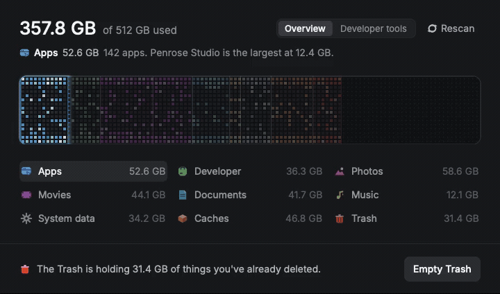
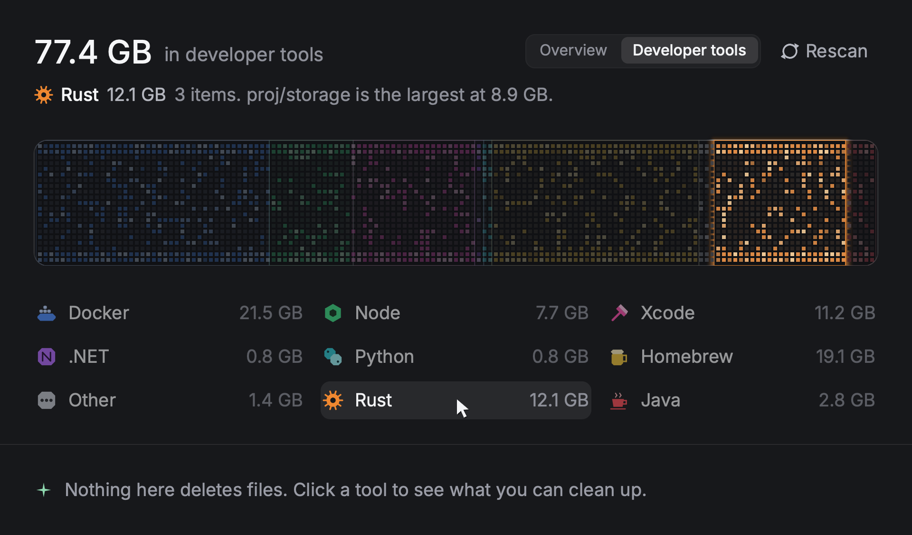
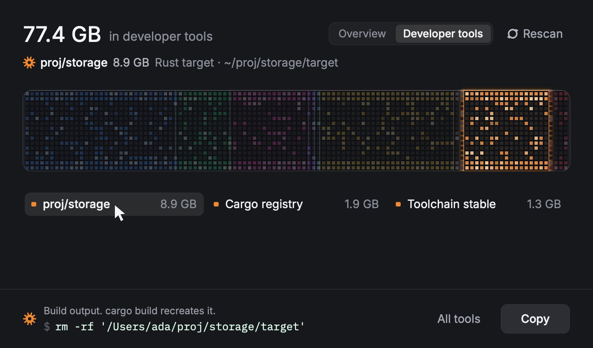

# Storage Scanner

A native disk map, written in Rust with [Rune](https://github.com/anomalyco/rune). The window is the card. Used space is a row of glowing cells, one run per category; free space is the dim grid beside them. Emptying the Trash burns its cells off the bar. Caches are displayed but cannot be cleared. A second tab, **Developer tools**, shows what package managers, toolchains and build folders hold in the same bar-and-legend style; click a family, then an item, for the cleanup command to run yourself.

Design reference: [Storage scanner by @kshvbgde](https://x.com/bestsaasdesigns/status/2121105777415090259). The frames it was matched against are in `docs/design/`.

## Clear with fire

[](docs/fire-clear.mp4)

The fire effect from UI Lab burns the Trash area after confirmation. Cancel leaves it untouched. This clip uses demo mode, so no real files are deleted.

[Watch the 60 fps MP4](docs/fire-clear.mp4).

## Build and run

Rust 1.85 or newer (edition 2024). The window uses Metal on macOS and Vulkan or DX12 elsewhere. A machine with no GPU can render through Lavapipe:

```sh
sudo apt install mesa-vulkan-drivers
export VK_ICD_FILENAMES=/usr/share/vulkan/icd.d/lvp_icd.json
```

```sh
cargo run --release
cargo run --release -- --demo
```

On Linux the default is the demo: a fixed 512 GB disk (357.8 GB used) and no deletes. `--real` walks the home directory instead. On macOS and Windows the real walk is the default; `--demo` forces the designed dataset.

**Empty Trash** asks first. In the demo it only plays the animation. In real mode it permanently deletes children of `~/.Trash` and nothing else. Cache deletion is blocked in both the UI and backend; `~/Library/Caches` is scanned for display only. A symlinked Trash root is refused, and symlinks inside are unlinked without following them.

The fire clip above uses the demo disk and is recorded with the headless renderer (`--demo --script scripts/design-qa.json --video docs/fire-clear.mp4`).

## Developer tools tab



The second tab is drawn the way the overview is: the dot-matrix bar, a status line that follows the pointer, a 3×3 legend, and a footer. Each segment and legend cell is a tool family: Docker, Node, Xcode, .NET, Python, Homebrew, Other (Go, Trivy, JetBrains, Composer), Rust and Java. A family keeps its bar slot and colour across scans.

It measures the first time the tab opens; **Rescan** on the tab measures again from empty. While it measures, the bar grows on the disk's scale with the scan glow and the status line shows what is being measured, as the overview's scan does. When it finishes, the bar eases to the developer total so the families fill it.



Click a family (its bar segment or legend cell) and the legend lists that family's items, largest first, three to a row. Click an item and the footer shows what cleaning it does and the command to paste into a terminal. **Copy** puts the command on the clipboard, and its text can be selected too. **All tools** goes back to the families. There is no clear button, and the app never runs the command. A family opens only once a measurement has finished, so its items never re-rank under the pointer.

- **Tool caches and toolchains**: the Cargo shared target folder (`CARGO_TARGET_DIR` or `build.target-dir`), Cargo registry, each rustup toolchain, npm, pnpm, Yarn, Bun, Deno, node-gyp, Playwright, Homebrew downloads and packages, Docker Desktop and Docker Scout, NuGet and each .NET SDK, pip, uv, Poetry, Maven, Gradle, Coursier, the Java language server, Go build and module caches, Xcode DerivedData, device support and simulators, CocoaPods, SwiftPM, Trivy, JetBrains and Composer. Only the ones that exist show. The list is in `src/devtools/catalog.rs`.
- **Project build output**: the home folder is walked for `node_modules`, and for build folders next to their project file: `target` beside `Cargo.toml` or `pom.xml`, `bin` and `obj` beside a `.csproj`, `.venv` with a `pyvenv.cfg`, `.next` beside `package.json`, `build` and `.gradle` beside a Gradle build, `Pods` beside a `Podfile`, `.build` beside `Package.swift`. A `bin` or `target` folder without its project file is left out. The walk skips `~/Library`, Pictures, Movies, Music, hidden folders and app bundles.

Sizes are allocated blocks, as `du` reports them, and a hard-linked file counts once (pnpm links its store into every `node_modules`). Items under 50 MB fold into one cell per family; they still count toward the family's size.

Where a tool has its own cleanup command (`npm cache clean --force`, `brew cleanup --prune=all`, `docker system prune -a`, `go clean -modcache`, `rustup toolchain uninstall …`) the footer shows it. Otherwise it shows `rm -rf` with absolute, single-quoted paths, which paste the same way into zsh, bash and fish. Rust `target` folders get `rm -rf` rather than `cargo clean`, because with `CARGO_TARGET_DIR` set `cargo clean` would empty the shared folder instead. System .NET SDKs need `sudo`.

## Screenshots

`scripts/shots.sh` records the demo with Rune's headless renderer (the same one as the window):

| | |
| --- | --- |
| Scanning | `out/scanning.png` |
| Idle, Apps hovered | `out/idle-apps.png` |
| Emptying Trash | `out/clearing-caches.png` |
| After emptying the Trash | `out/after-trash.png` |
| Developer tools, Rust hovered | `out/dev-tools.png` |
| Developer tools, a Rust item selected | `out/dev-tools-command.png` |

## How files are counted

The real scanner walks the home directory (and `/Applications` when it is there) and buckets file bytes:

- **Trash** — `~/.Trash`
- **Caches** — `~/Library/Caches`
- **Apps** — `~/Applications`, `/Applications`, and `*.app` bundles
- **Developer** — `~/Library/Developer`, plus `node_modules`, `target`, `.cargo`, and the other build directories in `src/scan.rs`
- **Photos, Movies, Music, Documents** — those folders, and files with a matching extension
- **System data** — disk used, minus the categories above

## Fonts

Inter (Regular, Medium, SemiBold, Bold) is bundled under the SIL Open Font License, `assets/Inter-LICENSE.txt`. Paths use IBM Plex Mono, also OFL, `assets/IBMPlexMono-LICENSE.txt`.
