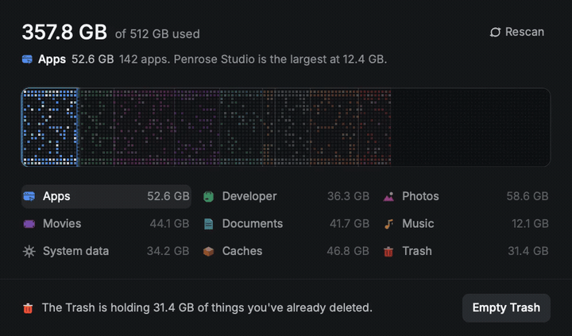

# Storage Scanner

A native disk map, written in Rust with [Rune](https://github.com/anomalyco/rune). The window is the card. Used space is a row of glowing cells, one run per category; free space is the dim grid beside them. Emptying the Trash burns its cells off the bar. Caches are displayed but cannot be cleared.

Design reference: [Storage scanner by @kshvbgde](https://x.com/bestsaasdesigns/status/2121105777415090259). The frames it was matched against are in `docs/design/`.

## Clear with fire

[](docs/fire-clear.mp4)

The fire effect from UI Lab burns the Trash area after confirmation. Cancel leaves it untouched. This clip uses demo mode, so no real files are deleted.

[Watch the 60 fps MP4](docs/fire-clear.mp4).

## Build and run

Rust 1.85 or newer (edition 2024). The window uses Metal on macOS and Vulkan or DX12 elsewhere. A machine with no GPU can render through Lavapipe:

```sh
sudo apt install mesa-vulkan-drivers
export VK_ICD_FILENAMES=/usr/share/vulkan/icd.d/lvp_icd.json
```

```sh
cargo run --release
cargo run --release -- --demo
```

On Linux the default is the demo: a fixed 512 GB disk (357.8 GB used) and no deletes. `--real` walks the home directory instead. On macOS and Windows the real walk is the default; `--demo` forces the designed dataset.

**Empty Trash** asks first. In the demo it only plays the animation. In real mode it permanently deletes children of `~/.Trash` and nothing else. Cache deletion is blocked in both the UI and backend; `~/Library/Caches` is scanned for display only. A symlinked Trash root is refused, and symlinks inside are unlinked without following them.

The fire clip above uses the demo disk and is recorded with the headless renderer (`--demo --script scripts/design-qa.json --video docs/fire-clear.mp4`).

## Screenshots

`scripts/shots.sh` records the demo with Rune's headless renderer (the same one as the window):

| | |
| --- | --- |
| Scanning | `out/scanning.png` |
| Idle, Apps hovered | `out/idle-apps.png` |
| Emptying Trash | `out/clearing-caches.png` |
| After emptying the Trash | `out/after-trash.png` |

## How files are counted

The real scanner walks the home directory (and `/Applications` when it is there) and buckets file bytes:

- **Trash** — `~/.Trash`
- **Caches** — `~/Library/Caches`
- **Apps** — `~/Applications`, `/Applications`, and `*.app` bundles
- **Developer** — `~/Library/Developer`, plus `node_modules`, `target`, `.cargo`, and the other build directories in `src/scan.rs`
- **Photos, Movies, Music, Documents** — those folders, and files with a matching extension
- **System data** — disk used, minus the categories above

## Fonts

Inter (Regular, Medium, SemiBold, Bold) is bundled under the SIL Open Font License, `assets/Inter-LICENSE.txt`. Paths use IBM Plex Mono, also OFL, `assets/IBMPlexMono-LICENSE.txt`.
