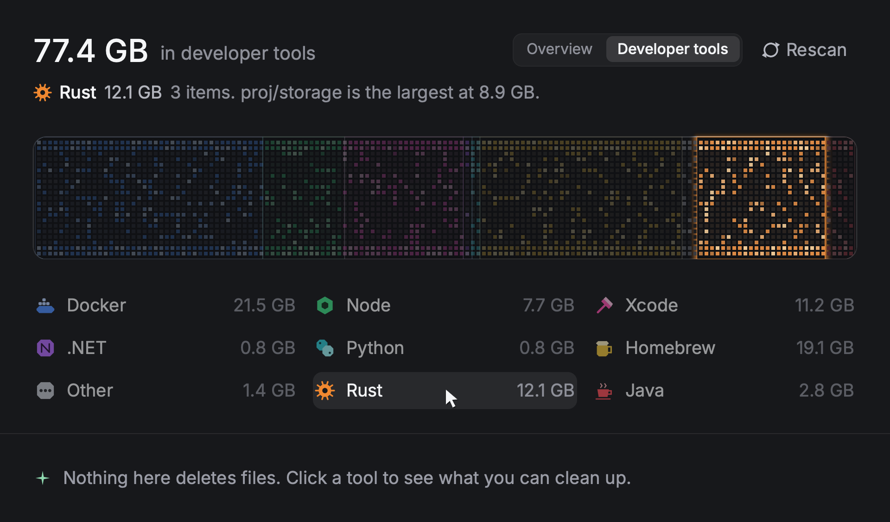
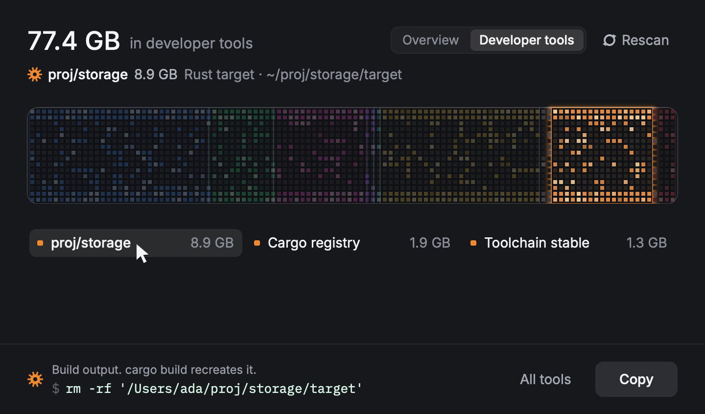

# Developer tools tab

The second tab is drawn the way the overview is: the dot-matrix bar, a status line that follows the pointer, a 3×3 legend, and a footer. Each segment and legend cell is a tool family: Docker, Node, Xcode, .NET, Python, Homebrew, Other (Go, Trivy, JetBrains, Composer), Rust and Java. A family keeps its bar slot and colour across scans.

## Measuring

It measures the first time the tab opens; **Rescan** on the tab measures again from empty. While it measures, the bar grows on the disk's scale with the scan glow and the status line shows what is being measured, as the overview's scan does. When it finishes, the bar eases to the developer total so the families fill it.

## Cleanup commands

Click a family (its bar segment or legend cell) and the legend lists that family's items, largest first, three to a row. Click an item and the footer shows what cleaning it does and the command to paste into a terminal. **Copy** puts the command on the clipboard, and its text can be selected too. **All tools** goes back to the families. There is no clear button, and the app never runs the command. A family opens only once a measurement has finished, so its items never re-rank under the pointer.

Where a tool has its own cleanup command (`npm cache clean --force`, `brew cleanup --prune=all`, `docker system prune -a`, `go clean -modcache`, `rustup toolchain uninstall …`) the footer shows it. Otherwise it shows `rm -rf` with absolute, single-quoted paths, which paste the same way into zsh, bash and fish. Rust `target` folders get `rm -rf` rather than `cargo clean`, because with `CARGO_TARGET_DIR` set `cargo clean` would empty the shared folder instead. System .NET SDKs need `sudo`.

## What is measured

- **Tool caches and toolchains**: the Cargo shared target folder (`CARGO_TARGET_DIR` or `build.target-dir`), Cargo registry, each rustup toolchain, npm, pnpm, Yarn, Bun, Deno, node-gyp, Playwright, Homebrew downloads and packages, Docker Desktop and Docker Scout, NuGet and each .NET SDK, pip, uv, Poetry, Maven, Gradle, Coursier, the Java language server, Go build and module caches, Xcode DerivedData, device support and simulators, CocoaPods, SwiftPM, Trivy, JetBrains and Composer. Only the ones that exist show. The list is in `src/devtools/catalog.rs`.
- **Project build output**: the home folder is walked for `node_modules`, and for build folders next to their project file: `target` beside `Cargo.toml` or `pom.xml`, `bin` and `obj` beside a `.csproj`, `.venv` with a `pyvenv.cfg`, `.next` beside `package.json`, `build` and `.gradle` beside a Gradle build, `Pods` beside a `Podfile`, `.build` beside `Package.swift`. A `bin` or `target` folder without its project file is left out. The walk skips `~/Library`, Pictures, Movies, Music, hidden folders and app bundles.

Sizes are allocated blocks, as `du` reports them, and a hard-linked file counts once (pnpm links its store into every `node_modules`). Items under 50 MB fold into one cell per family; they still count toward the family's size.
