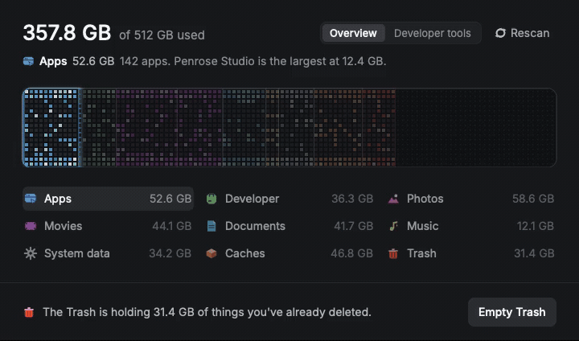

# Overview tab

The window is the card. Used space is a row of glowing cells, one run per category; free space is the dim grid beside them. Emptying the Trash burns its cells off the bar. Caches are displayed but cannot be cleared.

## Empty Trash

**Empty Trash** asks first. In the demo it only plays the animation. In real mode it permanently deletes children of `~/.Trash` and nothing else. Cache deletion is blocked in both the UI and backend; `~/Library/Caches` is scanned for display only. A symlinked Trash root is refused, and symlinks inside are unlinked without following them.

## Clear with fire

The fire effect from UI Lab burns the Trash area after confirmation. Cancel leaves it untouched. This clip uses demo mode, so no real files are deleted.

[Watch the 60 fps MP4](fire-clear.mp4).

The clip uses the demo disk and is recorded with the headless renderer (`--demo --scene idle --scale 1 --fps 60 --script scripts/design-qa.json --video docs/fire-clear.mp4`).

## How files are counted

The real scanner walks the home directory (and `/Applications` when it is there) and buckets file bytes:

- **Trash** — `~/.Trash`
- **Caches** — `~/Library/Caches`
- **Apps** — `~/Applications`, `/Applications`, and `*.app` bundles
- **Developer** — `~/Library/Developer`, plus `node_modules`, `target`, `.cargo`, and the other build directories in `src/scan.rs`
- **Photos, Movies, Music, Documents** — those folders, and files with a matching extension
- **System data** — disk used, minus the categories above
